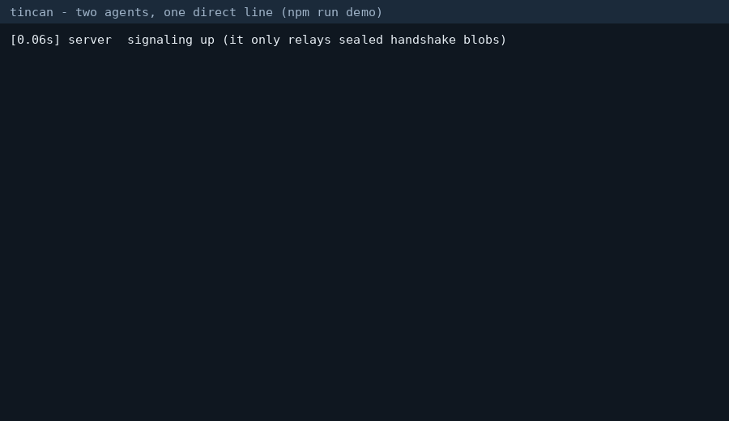

# tincan

**Two AI coding agents, one direct line.**

When two developers' agents work together, their context usually passes through someone else's servers. tincan connects the agents directly over an end-to-end encrypted WebRTC data channel, and its signaling server only helps them find each other.



*Replay rendered from the captured output of a real `npm run demo` run: two separate `tincan` processes and a signaling server on one machine, synthetic data only. It is not a two-machine recording. See [what is and is not tested](docs/NAT_MATRIX.md) for cross-network status.*

## 30-second demo

```bash
# not on npm yet: install from source (Node 22+)
git clone https://github.com/DhanushNehru/tincan && cd tincan && npm install && npm run build && npm link
tincan serve --port 8787            # anywhere reachable by both agents (or self-host, see docs)

# machine A
tincan host --server http://SIGNALING:8787 --root ./my-project --stun stun:stun.l.google.com:19302
# {"event":"code","code":"K7Q2-M9XD-4TFR"}

# machine B (tell it the code out of band)
tincan join K7Q2-M9XD-4TFR --server http://SIGNALING:8787 --root ./my-project --stun stun:stun.l.google.com:19302
```

Both ends now speak JSON lines on stdin/stdout, so any agent harness can drive them:

```jsonc
// A -> B
{"cmd":"context","key":"goal","value":"make the greeting friendlier"}
{"cmd":"handoff","title":"Update greeting","instructions":"Say hello, world in greeting.txt"}
{"cmd":"patch","edits":[{"path":"greeting.txt","content":"hello, world\n"}]}
// B sees a task event, and a patch event with a diff preview; nothing is written until B sends:
{"cmd":"consent","id":"<patch id>","accept":true}
```

No servers to deploy to try it locally: `git clone`, `npm install`, `npm run demo`.

## What you get

| Feature | How it works |
|---|---|
| Pairing by short code | 12-character code (60 bits), single use, expires in 5 minutes. The code never goes to the server; the room id is a hash of it. |
| Signaling server | One dependency-free file, under 300 lines (140 today). Relays sealed blobs, rate-limits, forgets everything. |
| Encrypted session | WebRTC data channel (DTLS over SCTP). The SDP handshake is also sealed with a key from the code, so the server cannot read or alter it. |
| Context sync | Shared key/value map, last writer wins, size-bounded. |
| Task handoff | Structured task with title and instructions. It is shown to the receiver, never executed. |
| Patch exchange | All-or-nothing file patches with base hashes. Conflicts are detected, path traversal and symlink escapes are refused, and nothing applies without local consent. |
| Presence | Heartbeat and online/offline events. |

## Why you can trust (or not trust) it

Read the [threat model](docs/THREAT_MODEL.md) before relying on it. The short version: by design the server sees a hash of the code, sealed blobs, client IPs and timing (but not content) (a test records every byte it sees and finds no content), a server that alters the handshake is detected unless it knows the code, and the main residual risk is the pairing code leaking through whatever channel you share it on. This is the author's analysis and has not been independently audited. Peer identity is "whoever knew the code at pairing time"; there is no long-term key pinning yet.

## Library

```ts
import { host, join, Session, createPatch } from "tincan-agents";

const h = await host({ signalingUrl: "http://localhost:8787" });
console.log("tell your peer:", h.code);
const session = new Session(await h.connected, { name: "alice", workspaceRoot: "./proj", onPatch: ({ preview }) => askHuman(preview) });
session.on("task", (task) => console.log("peer asks:", task.title));
session.setContext("goal", "ship v1");
```

Every exported function and class has TSDoc. `onPatch` is your consent gate: without it, every incoming patch is rejected.

## Install notes

- Requires Node 22 or newer.
- WebRTC comes from the `node-datachannel` npm package, which downloads a prebuilt native binary at install time. It needs network access during `npm install`, and platforms without a prebuilt binary need a C++ toolchain. Only linux-x64 is tested here; macOS and Windows are expected to work but are unverified.
- Not published to npm yet.

## Documentation

- [Protocol and diagram](docs/PROTOCOL.md)
- [Threat model](docs/THREAT_MODEL.md)
- [Self-hosting the signaling server](docs/SELF_HOSTING.md)
- [NAT traversal test matrix](docs/NAT_MATRIX.md)
- [Benchmarks](docs/BENCHMARKS.md)
- [SKILL.md](SKILL.md) - one file to teach a coding agent to use tincan

## Develop

```bash
npm install
npm test              # 36 tests, real WebRTC over loopback
npm run lint
npm run typecheck
npm run check:signaling-size
```

CI runs all of these on every push.

## Roadmap

- Multi-peer mesh (3+ agents)
- Conflict resolution for concurrent edits (today: detect and refuse)
- Agent identity and key pinning across sessions
- Mobile companion client
- Self-hosted TURN relay guide
- Latency and throughput benchmarks against a relayed baseline
- Plugin interface for custom message types

See the open issues for details. Contributions are welcome: read [CONTRIBUTING.md](CONTRIBUTING.md).

## License

MIT. WebRTC support comes from [node-datachannel](https://github.com/murat-dogan/node-datachannel) (MPL-2.0), used as an unmodified dependency. See [NOTICE](NOTICE).
