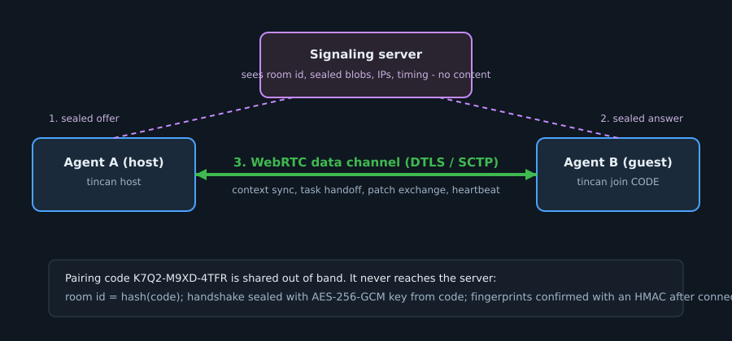

# Protocol

## 1. Pairing

1. Host generates a code `K7Q2-M9XD-4TFR` and derives `room`, `signalKey`, `confirmKey` from it.
2. Host `POST /v1/rooms/{room}`, builds a WebRTC offer, waits for ICE gathering to finish, then posts `AES-GCM(signalKey, offer)` as a host blob.
3. Guest derives the same keys from the typed code, polls the room, opens the host blob (fails if the code is wrong or the blob was altered), and posts a sealed answer.
4. Host opens the answer, applies it, and the data channel (label `tincan`) opens over DTLS/SCTP.
5. Both sides send `HMAC(confirmKey, role | hostFingerprint | guestFingerprint)` as the first message and verify the other's. Mismatch closes the link.
6. Host deletes the room.

ICE is not trickled: the SDP is sent complete, so every candidate is covered by the sealed blob.

## 2. Framing

Each message is cut into chunks of up to 16,000 bytes. The first byte is `1` (more follows) or `0` (final). The receiver reassembles up to 1 MiB and closes the link if a message grows past that.

## 3. Session messages

JSON objects with an increasing `seq` per direction.

| `t` | Direction | Meaning |
|---|---|---|
| `hello` | both | `{id, name, ctx}` - peer id, display name, full context snapshot |
| `ping` / `pong` | both | heartbeat (default every 5 s, offline after 15 s of silence) |
| `ctx` | both | `{key, entry:{value, clock, by}}` - last writer wins by `(clock, by)` |
| `task` | sender to receiver | `{task:{id, title, instructions, files?}}` |
| `taskReply` | receiver to sender | `{id, status: accepted\|declined\|done\|failed, note?}` |
| `patch` | sender to receiver | `{id, patch:{files:[{path, content\|null, baseSha256\|null}]}}` |
| `patchOutcome` | receiver to sender | `{id, status: applied\|rejected\|conflict, conflicts?, note?}` |

## 4. Signaling HTTP API

| Request | Purpose |
|---|---|
| `POST /v1/rooms/{room}` | create (room is 32 hex chars) |
| `POST /v1/rooms/{room}/blobs` `{from, data}` | post a sealed blob |
| `GET /v1/rooms/{room}/blobs?from=&after=` | long-poll blobs |
| `DELETE /v1/rooms/{room}` | close |
| `GET /healthz` | liveness |

## 5. CLI JSON lines

Events on stdout: `code`, `ready`, `context`, `task`, `taskReply`, `patch` (consent request with `preview`), `patchOutcome`, `presence`, `sent`, `error`, `close`.
Commands on stdin: `context`, `handoff`, `reply`, `patch`, `consent`, `quit`.
